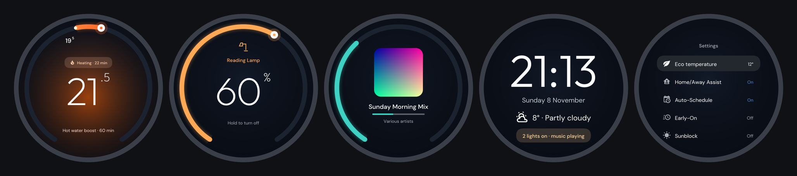
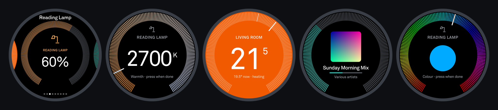
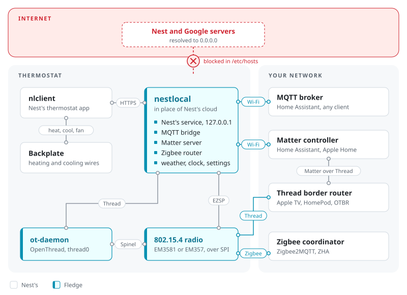
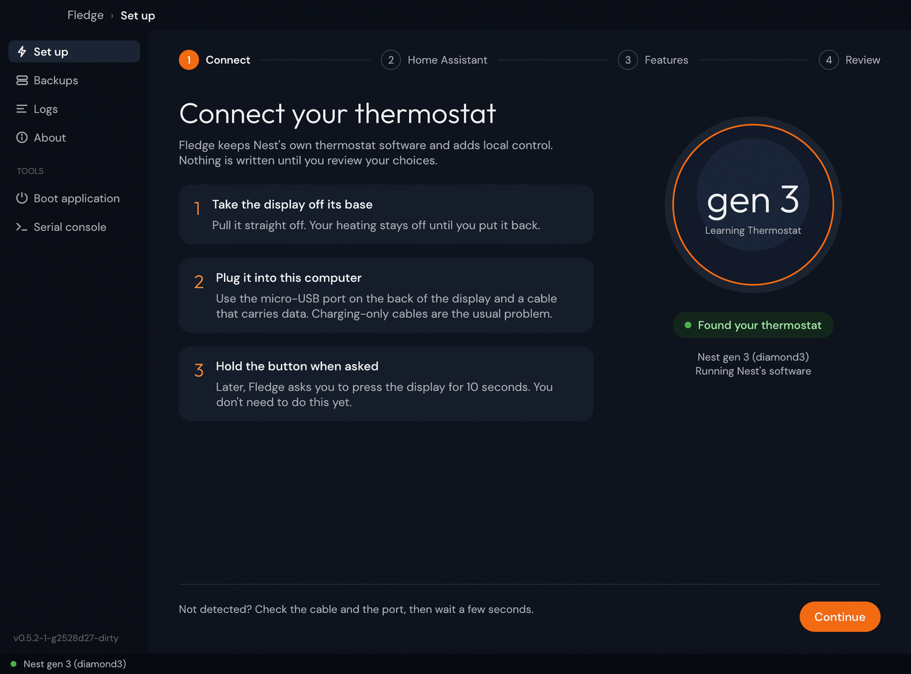

<p align="center">
  
</p>

<h1 align="center">Fledge</h1>

<p align="center">
  <b>Your Nest thermostat, out of the nest.</b><br>
  Root a Nest Learning Thermostat over USB, cut it loose from Google's cloud, and put Home Assistant on its own screen.<br>
  <a href="https://sysmoon14.github.io/fledge/">See it move: a 50-second walk through the screens</a>
</p>

<p align="center">
  <a href="https://github.com/sysmoon14/fledge/releases"></a>
  <a href="https://github.com/sysmoon14/fledge-homeassistant"></a>
  <a href="LICENSE"></a>
</p>

<p align="center">
  
</p>

<p align="center">
  
  <br>
  <sub>Fledge's look (top) is the default. The Nest's own look (bottom) is one setting away: Settings → Theme on the thermostat.</sub>
</p>

The Nest's ring is the best physical control in the house. Fledge keeps it, and
keeps everything the Nest does well (heating, learning, safety, its own menus),
then hands it the rest of your home:

- **Local, cloud-free control.** MQTT, Matter (over Wi-Fi or Thread) or
  Zigbee, on your own network. No Google account, no internet needed.
- **Home Assistant on the thermostat's screen.** Walk up, and your devices
  show zoomed out around the thermostat: turn to browse, press to open. Dim
  lights, set their warmth and colour, set other heating zones, turn a
  speaker up and see what's playing, arm and disarm your alarm with its code
  entered on the ring, all with the Nest's own clicks.
- **A thermostat card and Settings of its own.** The thermostat's dial,
  Eco, heating on or off and a hot water boost, and its everyday Settings
  (Eco temperature, Home/Away Assist, Auto-Schedule, Early-On, Sunblock,
  units, Fledge updates), in the same style. Nest's own menus are a press
  away for the rest, and Nest's own dial is a setting.
- **It feels native.** Drawn at 60 frames a second, in Fledge's own look or
  the Nest's (Settings → Theme). On an open card, press for its options and
  long press to switch a light, pause the music or run a scene.
- **Updates from Home Assistant.** The thermostat's software updates from
  an ordinary Home Assistant update entity, signed, with automatic rollback.

The cards come with the **[Fledge integration for Home Assistant](https://github.com/sysmoon14/fledge-homeassistant)**:
pick your devices, and choose (or automate) what the thermostat wakes to.

> [!WARNING]
> **Fledge has been tested on exactly one thermostat.** That's a Nest Learning
> Thermostat (3rd generation) on Nest firmware **6.4-8**, a European model with
> a Heat Link driving heating and hot water, set up with **MQTT and Home
> Assistant**. Nothing else has been tested with Fledge: other generations, other
> firmware versions, US or multi-stage wiring, heat pumps, cooling, Matter,
> Zigbee and Thread. They may work, since Fledge builds on
> [unfr0zen](https://github.com/unfr0zen/unfr0zen), which was tested more widely
> ([Supported thermostats](#supported-thermostats)), but Fledge changes a lot on
> top of it. If you run it on anything else, you are the first.

> [!CAUTION]
> **This rewrites the flash of the device that runs your heating.** A failed run
> or a bad patch can leave the thermostat unbootable, or running without
> controlling your heating or cooling. Back up the NAND before the first run
> ([Undo it](#undo-it)) and have another way to heat or cool the house while you
> test.
>
> Claude Code has been used throughout Fledge's development. Fledge comes
> **without any warranty**: you use it at your own risk ([Disclaimers](#disclaimers)).

## How it works

<picture>
  <source media="(prefers-color-scheme: dark)" srcset="assets/overview-dark.svg">
  
</picture>

Nest's own app, nlclient, keeps running the thermostat: the heating, the
schedule, the learning. Fledge adds **nestlocal** beside it, which stands in for
Google's cloud and speaks MQTT, Matter and Zigbee instead. For the home screen
cards, nlclient hands its display and ring to nestlocal while the cards show,
including the thermostat's own card and Settings; nestlocal sets the
thermostat through the same settings Home Assistant uses. nlclient's own
screens come back for Nest's dial and More Nest settings.

## What you get

| | Stock | With Fledge |
|-|-|-|
| Control from | the Nest/Google Home app, through Google's cloud | Home Assistant or any MQTT client, Matter controller or Zigbee coordinator, on your network |
| On its screen | the thermostat | the thermostat, plus your lights, other heating zones and speakers (MQTT with Home Assistant); or only your cards, as a panel (turn off **Act as a thermostat**) |
| Internet access | required | not needed: the unit only has to join your Wi-Fi |
| Nest and Google servers | always contacted | blocked with Block cloud (`--block-cloud`) |
| Integrations | none | MQTT, Matter over Wi-Fi or Thread, Zigbee router |
| Updates | Google's | signed releases, installed from Home Assistant, rolled back if they fail |
| Extras | none | SSH (`--ssh`), Doom (`--doom`), whole-NAND backup and restore |

## Supported thermostats

**Fledge supports the Nest Learning Thermostat (3rd generation) only.**

> [!IMPORTANT]
> **Not supported: the Nest Learning Thermostat (1st and 2nd generation), the
> Nest Thermostat E and newer Nests.** Fledge's app recognises them, tells you
> so, and does nothing to them. **For those, use
> [unfr0zen](https://github.com/unfr0zen/unfr0zen).** That stays the case until
> I have hardware to develop and test on, or someone who does sends a pull
> request that has been tested on a real thermostat.

| Device | Codename | SoC | MQTT | Matter (Wi-Fi) | Matter (Thread) | Zigbee |
|-|-|-|-|-|-|-|
| Nest Learning Thermostat (3rd generation) | `diamond3` | i.MX6SoloX | Tested | Tested | Tested | Tested |

*Tested*: on a unit, by upstream unfr0zen, before Fledge's changes. Fledge
itself has only been tested on one unit:

| | Generation | Nest firmware | Setup |
|-|-|-|-|
| Tested with Fledge | 3rd | 6.4-8 | European, Heat Link, heating and hot water, MQTT with Home Assistant |
| Tested by upstream unfr0zen | 3rd | 5.9.4-5, 6.3-5, 6.4-8, 6.5-14 | |

Other firmware versions aren't blocked: the patch finds what it changes by its
structure and keeps the stock nlclient beside the run log. Running Fledge on
something not in the first row? [Open an issue](https://github.com/sysmoon14/fledge/issues/new)
with the run log, whether it worked or not.

The home screen cards are developed and tested on the 3rd generation.

- **Matter and sleep:** the thermostat sleeps and wakes for a controller's
  messages, and a controller looking it up wakes it too.
- **Thread and Zigbee** share the thermostat's 802.15.4 radio (an
  EM357 or EM3581 on SPI), so only one of them can be on, and on European
  models either one replaces the wireless Heat Link connection. Zigbee drives
  it directly; Matter over Thread goes through OpenThread's `ot-daemon`.

MQTT, Matter and Zigbee are nestlocal's: choosing any of them installs it on the
thermostat. With MQTT or Matter, the thermostat reaches the broker or the
controller over Wi-Fi, joined from its own menu (Settings → Network); the
network doesn't need internet access.

### Tested firmware

| Device | Nest firmware |
|-|-|
| Nest Learning Thermostat (3rd generation) | 5.9.4-5, 6.3-5, 6.4-8, 6.5-14 |

Other versions aren't blocked: Fledge patches them on their structure and
keeps the stock nlclient beside the run log. Running a version not listed here?
[Open an issue](https://github.com/sysmoon14/fledge/issues) with the run log.

## Get started

1. **A micro-USB data cable.** Charge-only cables won't work.
2. **The Fledge app.** Download it from the
   [latest release](https://github.com/sysmoon14/fledge/releases/latest), under
   Assets:

   | Your computer | Download |
   |-|-|
   | Mac (macOS 13 or later) | `Fledge-macos-universal-<version>.zip` |
   | Windows | `Fledge-windows-x86_64-<version>.zip`, or `-arm64` |
   | Linux (glibc 2.28 or later) | `Fledge-linux-x86_64-<version>.tar.gz`, or `-arm64`, `-riscv64` |

   Or build it yourself with the steps in [BUILDING.md](BUILDING.md).
3. **Set it up:** open the app and follow **Set up**: connect the thermostat,
   give it your Home Assistant's MQTT broker, choose its features, then review
   and patch. Review offers to back up the whole NAND first (**Back up, then
   patch**, the default); take it on the first run.
4. **In Home Assistant:** the thermostat appears through MQTT. Add the
   [Fledge integration](https://github.com/sysmoon14/fledge-homeassistant) to put
   your devices on its screen: download it, restart Home Assistant, then add it.

   [](https://my.home-assistant.io/redirect/hacs_repository/?owner=sysmoon14&repository=fledge-homeassistant&category=integration)
   [](https://my.home-assistant.io/redirect/config_flow_start/?domain=fledge)

<p align="center">
  
</p>

- **macOS:** the app is signed ad hoc, not notarized: run
  `xattr -dr com.apple.quarantine Fledge.app`, or allow it under System Settings → Privacy & Security.
- **Linux:** run it as your normal user, after the one-time USB setup below.

<details>
<summary>Linux: USB access and runtime dependencies</summary>

Run both the app and CLI as your normal user, without `sudo`. Both need the
same one-time udev setup below; neither requests elevated privileges. Keep the
`70-` prefix: the rule has to run before systemd's `73-seat-late.rules` for
`uaccess` to grant the active local user USB access.

```sh
sudo tee /etc/udev/rules.d/70-fledge.rules > /dev/null <<'EOF'
# i.MX ROM serial download, recovery U-Boot
ATTRS{idVendor}=="15a2", ATTRS{idProduct}=="0071", TAG+="uaccess", ENV{ID_MM_DEVICE_IGNORE}="1"
ATTRS{idVendor}=="18d1", ATTRS{idProduct}=="4ee0", TAG+="uaccess", ENV{ID_MM_DEVICE_IGNORE}="1"
# the recovery initramfs shell and the Nest application's console
ATTRS{idVendor}=="0525", ATTRS{idProduct}=="a4a7", TAG+="uaccess", ENV{ID_MM_DEVICE_IGNORE}="1"
ATTRS{idVendor}=="0525", ATTRS{idProduct}=="b4a4", TAG+="uaccess", ENV{ID_MM_DEVICE_IGNORE}="1"
ATTRS{idVendor}=="2464", ATTRS{idProduct}=="0030", TAG+="uaccess", ENV{ID_MM_DEVICE_IGNORE}="1"
ATTRS{idVendor}=="2464", ATTRS{idProduct}=="0031", TAG+="uaccess", ENV{ID_MM_DEVICE_IGNORE}="1"
EOF
sudo udevadm control --reload-rules && sudo udevadm trigger
```

Reconnect the unit afterwards if it is already plugged in. The same rules cover
both the USB device and its HID/serial interfaces as it switches recovery modes.

Logs go to `~/.local/share/fledge/logs/<timestamp>/fledge.log` (or under
`$XDG_DATA_HOME` when set).

| Dependency | Why |
|-|-|
| A Wayland or X11 desktop with OpenGL or Vulkan drivers (Arch: `mesa`, or your GPU's driver) | Draws the window. |
| `xdg-desktop-portal` and the backend for your desktop (Arch: `xdg-desktop-portal-gtk`, `-kde` or `-gnome`) | The file picker for the MQTT CA certificate. |
| `libudev` (part of systemd) | USB access. |

</details>

## The app and the command line

**App:** Set up is one guided flow: Connect, Home Assistant (the broker, and
updates through it), Features (how the Nest switches your boiler, blocking Google, Matter, Zigbee, SSH with a key
it can create, and password login off unless you allow it, the USB console,
Doom), then Review, which shows the choices,
offers the whole-NAND backup and folds away the developer options (dry run,
slot, device, entry point, overlay, another cloud, backplate simulator). The run
shows in place, and Done says what to do next. The sidebar's other pages are
Backups (the whole-NAND images the app keeps, with back up, restore and delete),
Logs (every run's steps and log), About and, under Tools, the 3rd generation's
application boot and a serial console on a patched unit's USB root shell. The
external temperature option isn't in the app: on a 3rd generation unit, turn it
on from Home Assistant with the Nest's **External temperature** switch (the unit
reboots into it), or patch with `--external-temperature`.
On a Heat Link model with no Heat Link (or with Zigbee or Thread on), answer
**Wired to the Nest's base, or no Heat Link** under Your heating, or turn on the
Nest's **Works With Nest boiler** switch in Home Assistant later (the unit
reboots into it); without it the Nest stops with error H71 or H74.

**CLI (Linux and macOS):** the same executable, run with arguments, works from a
terminal, over SSH or headless, with a few things the app doesn't have
(`--nand-image`, `verify`, `uboot`, `nlclient`). The executable is `fledge`; on
macOS it is `Fledge.app/Contents/MacOS/fledge`.
Windows has the app only.
```
fledge [OPTIONS] [COMMAND]

Commands:
  backup    Back up the whole NAND to a file, checked with a second read
  verify    Compare a NAND backup with the NAND
  restore   Write a verified NAND backup back to the NAND
  boot      Boot the application firmware (3rd generation)
  uboot     Load recovery U-Boot over USB and leave it at its prompt (3rd generation)
  nlclient  Patch a local stock nlclient, or restore it from its undo journal

Common options:
  --device <GEN>         the generation, instead of the USB identity
  --backup              Save the original root volume before patching
  --dry-run             List the changes, write nothing
  --mqtt <URL>          Relay to this MQTT broker
  --updates             Install Fledge's signed releases from Home Assistant (needs --mqtt)
  --matter              Serve the unit over Matter (default code 0347-100-5534)
  --matter-thread       Serve Matter over Thread too (replaces Heat Link; excludes --zigbee)
  --zigbee              Join a Zigbee network as a router (replaces Heat Link)
  --external-temperature  Regulate from temperatures sent to it; turns off Bluetooth (3rd generation)
  --doom                Install Doom, launched from the Fledge page in the Nest's settings
  --ssh                 Run an SSH server on the unit
  --ssh-key-only        SSH takes the --ssh-public-key only, refusing root's password
  --block-cloud         Cut the unit off from Nest's and Google's servers
```
Run it with `--help` for every option.

**On the thermostat:** Fledge adds a page to the Nest's own Settings for what
you turned on: Matter's pairing code and QR, Zigbee pairing, and Doom.

## Updating

- **The thermostat:** a unit patched with updates on (the app's default with
  Home Assistant; `--updates` on the command line) shows a Home Assistant update
  entity. Releases are signed; the unit checks the signature, installs, and
  rolls back by itself if the new build doesn't come up. It checks daily, and
  whenever the Fledge integration updates. With updates off it never checks,
  shows no update entity (and removes one an earlier patch left), and only a new
  patch from the app brings it a newer build.
- **The app:** release builds check for a newer release when they start and
  offer to install it. Development builds never update.

## Undo it
- **Before the first run:** Review's **Back up, then patch**, or the app's
  Backups page, Back up unit (or `fledge backup`), saves the whole NAND to a
  file, checked with a second read. `fledge verify` compares a backup with
  the unit.
- **To go back to stock:** Restore to unit (or `fledge restore`) writes
  that backup back to the unit.
- `--backup` also saves the original root volume before each patch.

## When something is wrong
**The app doesn't see the thermostat.** Use a USB cable that carries data:
charge-only cables are the usual cause. Connect to the USB port on the back of
the detached display, not the power-only USB port on a European stand or Heat
Link base. On Linux, add the
[udev rule](#get-started) and reconnect the unit.

**Windows stops with `ACM interface for 18d1:4ee0 did not appear` (3rd generation).**
An Android driver installed earlier has claimed the recovery device, so its
console gets no COM port. While the thermostat is in recovery, open Device
Manager, find **Android Bootloader Interface**, choose Update driver → Browse
my computer → Let me pick → Universal Serial Bus devices → **USB Composite
Device**. The choice persists; run again.

**macOS won't open the app.** It is signed ad hoc, not notarized: run
`xattr -dr com.apple.quarantine Fledge.app`, or allow it under System
Settings → Privacy & Security.

**Home Assistant shows the thermostat offline.** The availability topic is
online only while the thermostat's app calls in to nestlocal and nestlocal is
connected to the broker. Check that the unit is on Wi-Fi (Settings → Network)
and that it reaches the broker URL you gave it.

Still stuck? [Open an issue](https://github.com/sysmoon14/fledge/issues/new) with:
- How you ran it (app or CLI, with the options used) and the OS of your computer
- The full log of the run
- What the thermostat screen showed

## Disclaimers
Fledge is provided **as is, without any warranty**. We are **NOT** responsible
for any data loss, a bricked thermostat, damage to your heating or cooling
system, or anything else that happens to your device. By using Fledge you
accept full responsibility for the result.
- Modifying the thermostat voids its warranty and may break Google's services for it.
- Doom takes over the UI: while it runs the thermostat does not control the heating or cooling.
- Matter uses the test vendor ID (0xFFF1) and test attestation; controllers treat the unit as uncertified.
- Fledge is not affiliated with, endorsed or sponsored by Google LLC or Nest Labs.
  Nest and Nest Learning Thermostat are trademarks of Google LLC.

## Building
See [BUILDING.md](BUILDING.md).

## License
Fledge is licensed under the [GNU General Public License v3.0](LICENSE).
Bundled third-party components keep their own licenses: U-Boot and its patches
(GPL-2.0+), busybox (GPL-2.0), doomgeneric (GPL-2.0), the `zbwake` kernel
module (GPL-2.0). DOOM1.WAD is id Software's shareware episode, redistributed
under its shareware terms.

## Acknowledgements

Fledge is a fork of **[unfr0zen](https://github.com/unfr0zen/unfr0zen)**, and
it owes almost everything to **Will ([@will-tm](https://github.com/will-tm))**,
who wrote nearly all of unfr0zen and did the hard part:

- **Getting in.** Rooting the Nest over USB through the i.MX ROM's recovery
  mode, the gen 3 entry points and loaders, and an app that handles stalled
  serial links, refusing ROMs and secure-boot revisions it can't touch.
- **Doing it safely.** Full NAND backups (bad blocks and all), a patch to
  `nlclient` that finds its own way round each firmware and can always be undone,
  and a stock client left in place whenever a firmware isn't supported.
- **nestlocal.** Local control without Google's cloud over MQTT, Matter (Wi-Fi
  and Thread) and Zigbee, down to the radio, hot water
  boost, Works with Nest boilers and regulating from an external sensor.
- **Knowing the hardware.** Reverse engineering the Nest's client, screen and
  radios, and testing it all on real thermostats across firmware versions.

Fledge's own work, Home Assistant on the thermostat's screen and its releases,
sits on top of that foundation, and every Fledge release still carries it.
Thanks also to [@calin2k](https://github.com/calin2k) for their contributions
to unfr0zen.

If Fledge is useful to you, please
[star unfr0zen](https://github.com/unfr0zen/unfr0zen) too.

## Credits

- U-Boot (i.MX) — [NXP](https://github.com/nxp-imx/uboot-imx)
- BusyBox — [the BusyBox project](https://busybox.net)
- rs-matter — [Project CHIP](https://github.com/project-chip/rs-matter)
- OpenThread — [the OpenThread project](https://github.com/openthread/openthread)
- Gecko SDK / EmberZNet — [Silicon Labs](https://github.com/SiliconLabs/gecko_sdk)
- doomgeneric — [ozkl](https://github.com/ozkl/doomgeneric)
- DOOM — [id Software](https://github.com/id-Software/DOOM)
- Material Design Icons — [Pictogrammers](https://pictogrammers.com/library/mdi/), and Material Symbols — [Google](https://github.com/google/material-design-icons)
- CVE-2017-7932 and CVE-2017-7936 — [Quarkslab](https://quarkslab.com)
- diamond3 official loader — [@evan-hoddinott](https://github.com/evan-hoddinott)
- cuckoo loader (diamond/j49) — [@ajb142](https://github.com/ajb142)
